# UI style guide

What every Ones Servitude UI looks like and how it's built, taken from Studio on 2026-11-21. **Read this before building or reworking any UI**, so a new screen looks like it was always there.

Motion (how things appear, fade and write themselves in) has its own page: [systems/ui-motion.md](../systems/ui-motion.md).

**The game wins.** If Studio and this page disagree, Studio is right. Re-take the pictures and fix the numbers.

## The look in one paragraph

Dusk, faith and old paper. **Deep plum and violet** panels, **thin lavender lines**, **gold** for anything that matters: a name, a price, the selected thing. Shapes are **square and sharp**. There are no rounded rectangles; only circles get rounding. The **diamond (◆)** comes back everywhere: slots, emblems, bullets, ticks. **Silver-violet filigree** sits in panel corners. Type is **old-book serif**. Panels **fade into the world** at their edges instead of sitting on top of it as hard boxes. Nothing pops: everything eases in ([UIMotion](../systems/ui-motion.md)).

## Reference screens

**Current-style references** (copy these):

| Screen | Picture | Why it's a good reference |
|---|---|---|
| Soul pick (PVP, Session `SoulPickUI`) | 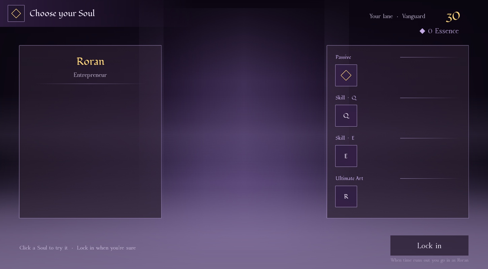 | The cleanest full screen: title bar fading to the right, twin panels, section headers with fading rules, gold name, foggy violet backdrop |
| Lane cards (Lobby `ScreenGui.LaneCardsFrame`) | 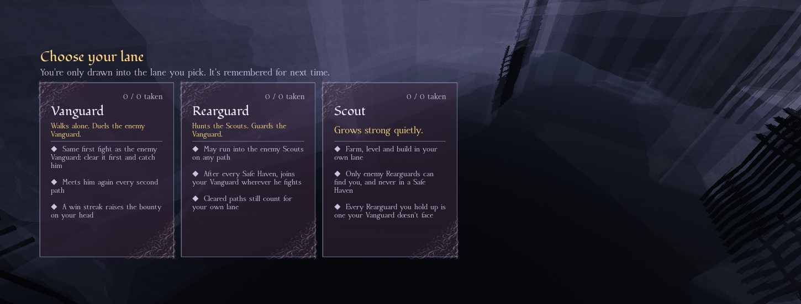 | Card recipe: plum panel + top-light gradient + lavender stroke + filigree corners, gold tagline, ◆ bullets |
| Convoke (Lobby `ConvokeUI`) | 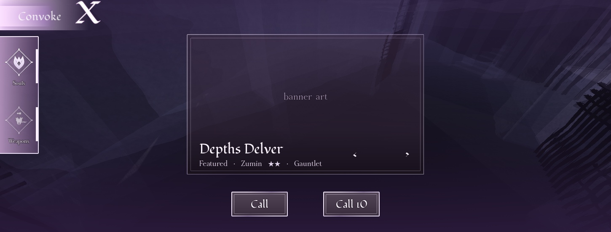 | Page title tab (top-left glow fading right with a big serif X), side tab rail, ornate double-rim buttons |
| Main menu (Lobby `MenuUI`) | 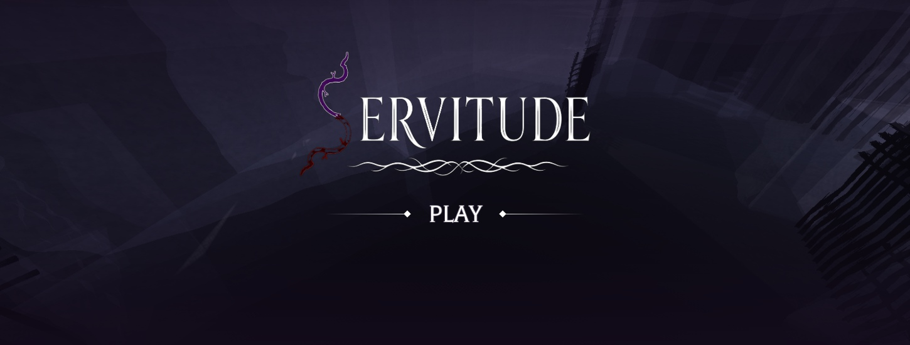 | Logo, flourish divider, `◆ ── PLAY ── ◆` button |
| HUD (Session) | 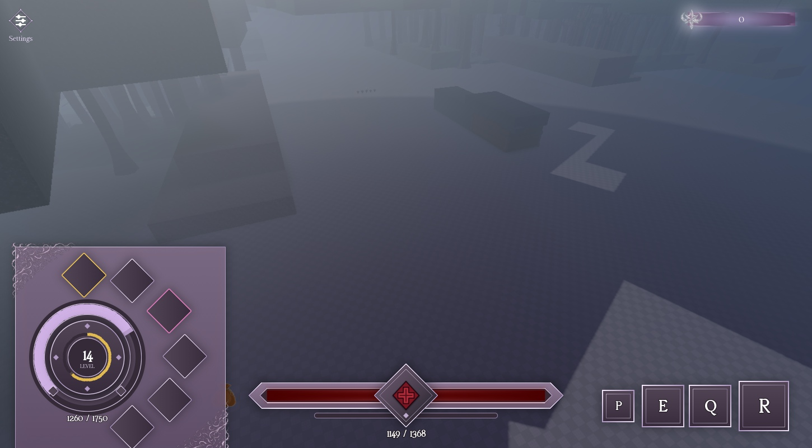 | Sigil (diamond weapon slots round a level disc), health bar with diamond crest, P/E/Q/R ornate slots, currency pill |
| HUD + bag, buff, combat tag | 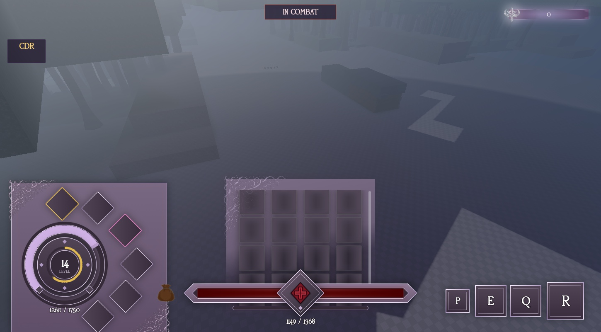 | Small inventory (filigree corner, dark slots), `IN COMBAT` tag, buff badge with gold name |
| Settings (both places) | 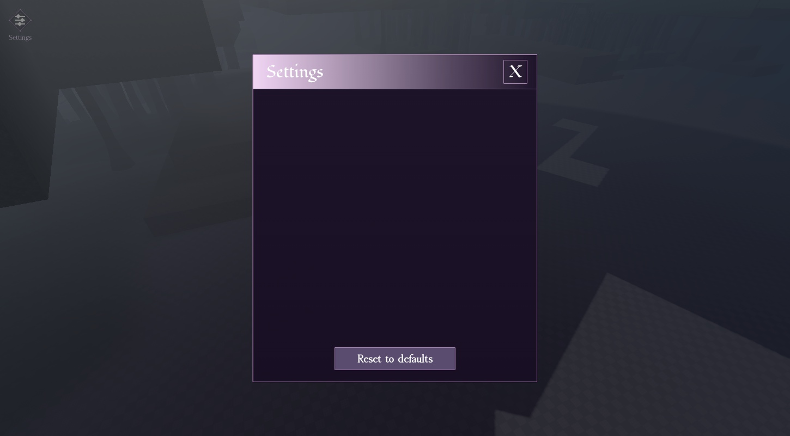 | Panel with a glowing title bar fading right; rows are built at runtime (empty in Edit) |
| Character Page / Inner Core (Lobby) | 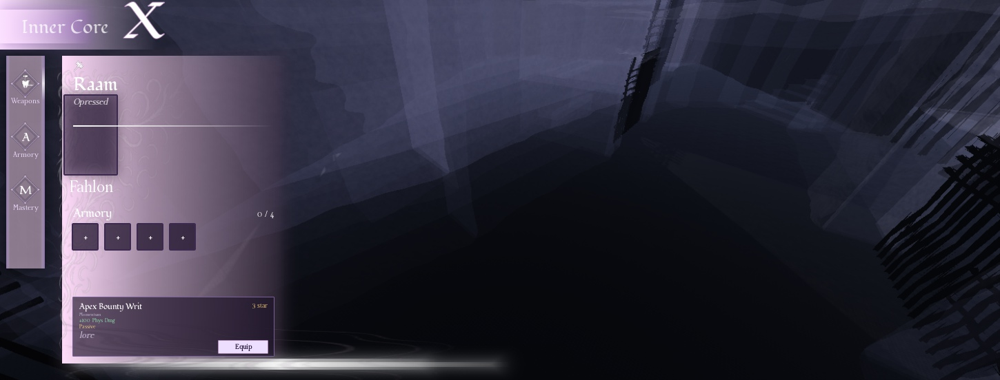 | Pale glow panel fading right, diamond tab buttons, artifact detail card. In Edit every tab shows at once, so it looks crowded |
| PVP lobby (Lobby) | 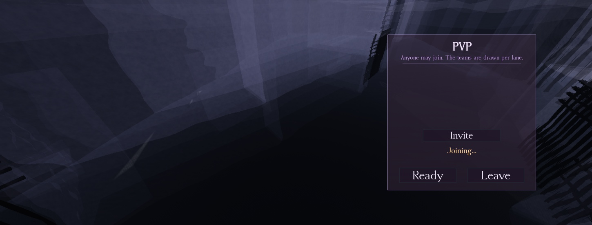 | Small panel: title, subtitle, rule, flat dark buttons, gold status line |
| Dialogue (Session `DialogueUI`) | 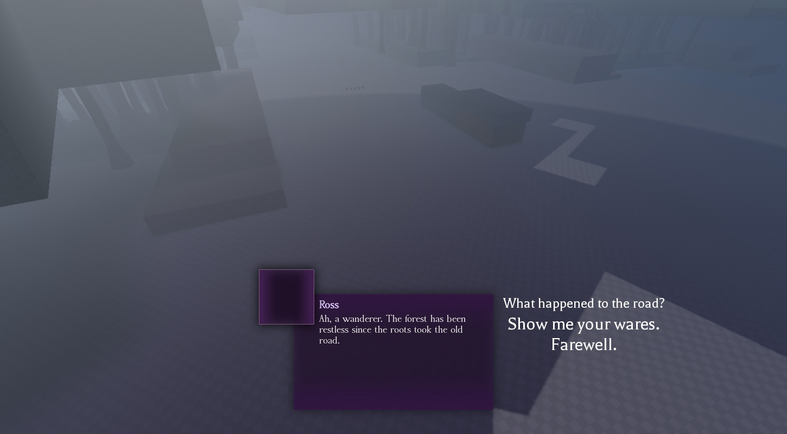 | Portrait frame + dark violet box; lilac speaker name, pale body; reply options as plain serif text (sample text filled in for the picture) |
| Shop (Session `NewShopUI`) | 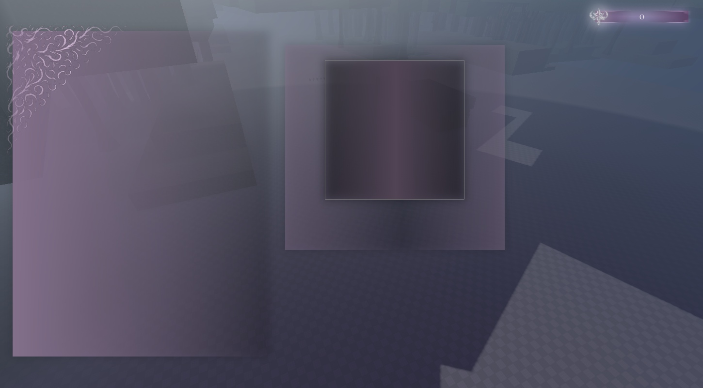 | Big filigree-cornered panel fading left to right; item slots are runtime-filled |
| Rarity borders (both) | 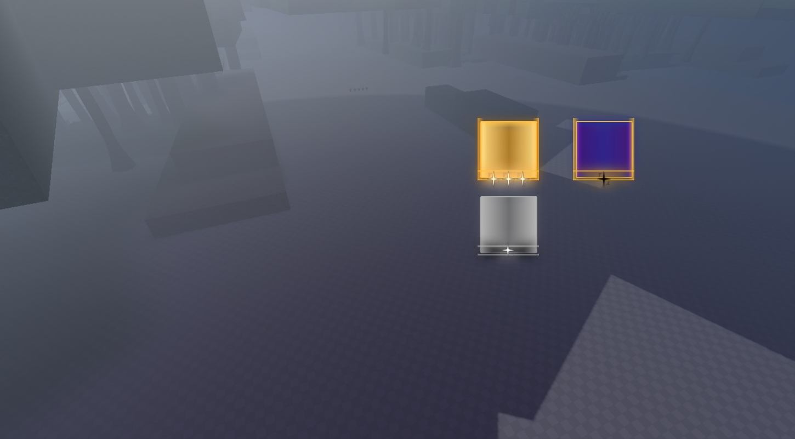 | 1-star silver, 3-star gold (✦✦✦), Personal violet + gold |
| Class card + affinity icons (Lobby) | 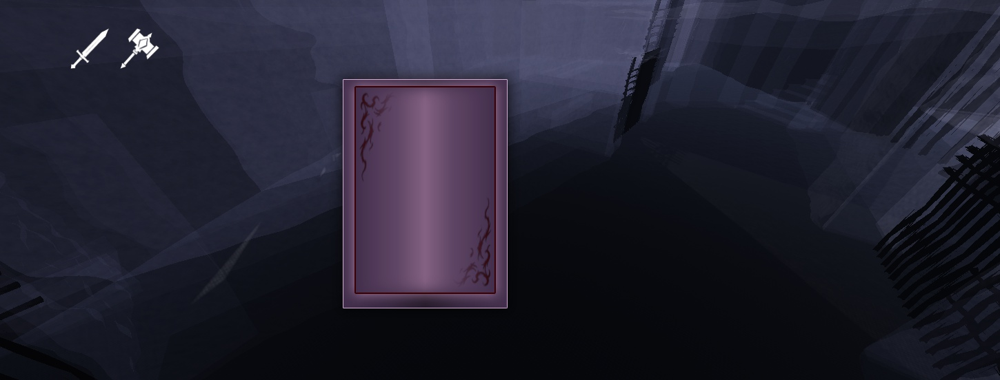 | Card with dark-red thorn ornaments; white flat affinity glyphs |

**Legacy, don't copy:** the Lobby's old dev panels (`StageSelectFrame`, `InventoryFrame`, `HostListFrame`, `WeaponInventoryFrame`, `ClassSelectFrame`). They use grey `25,25,30` boxes, SourceSans Bold and red/green buttons, from before the style existed. Restyle them when they're touched.

## Palette

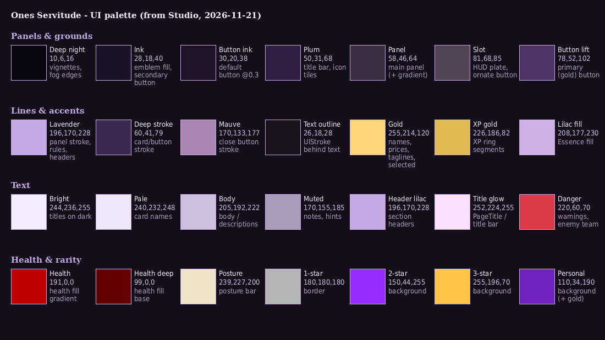

| Role | RGB | Used for |
|---|---|---|
| Deep night | 10,6,16 | Screen vignettes, fog edges |
| Ink | 28,18,40 | Emblem / tile fill (often @0.2–0.4), secondary (Cancel) button |
| Button ink | 30,20,38 @0.3 | Default flat button (Lock in, Leave, Ready) |
| Plum | 50,31,68 | Title bars, icon tiles, Character Page frames |
| **Panel** | **58,46,64** | Main panel colour, always with the panel gradient (below) |
| Slot | 81,68,85 | HUD plates, ornate buttons (Call), shop slots |
| Button lift | 78,52,102 | Primary (gold) button fill |
| **Lavender** | **196,170,228** | Panel strokes (1.5 px @0.45), rules, section headers |
| Deep stroke | 60,41,79 | Card / tile / secondary button stroke |
| Mauve | 170,133,177 | Close button stroke, Settings panel stroke |
| Text outline | 26,18,28 | UIStroke behind text on bright fills (1–1.4 px @0–0.35) |
| **Gold** | **255,214,120** | Soul / item names, prices, taglines, timers, primary button text + stroke, "selected" |
| XP gold | 226,186,82 | XP ring segments |
| Lilac fill | 208,177,230 | Essence fill bar |
| Title glow | 252,224,255 | Page title tab, title bar glow (fades right) |
| Text: bright | 244,236,255 / 240,232,248 / 250,244,255 | Titles, names on dark |
| Text: body | 205,192,222 | Descriptions, sub-labels |
| Text: muted | 170,155,185 | Notes, hints at the bottom |
| Text: header | 196,170,228 | Section headers ("Passive", "Skill · Q") |
| Danger | 220,60,70 / 214,84,96 | Warnings, enemy team headers |
| Health | 191,0,0 over 99,0,0 | Health fill; posture 239,227,200 |
| Rarity | 1★ 180,180,180 · 2★ 150,44,255 / 255,105,222 · 3★ 255,196,70 / 255,214,120 · Personal 110,34,190 + gold 236,184,60 | Item borders |

Pure white text exists on older pieces (shop prices, HUD numbers). New UI uses the tinted whites above.

## Typography

| Font (`Font.new` family) | Weight | Role | Examples |
|---|---|---|---|
| **Fondamento** | Regular | Display: screen titles, names, button labels, big numbers | "Choose your Soul", "Roran", "Call", "Settings", the 30 timer |
| **Accanthis ADF Std** | Regular / Bold | Body: descriptions, sub-labels, captions, flat button labels | Lane points, "Your lane · Vanguard", "Lock in", "Leave" |
| Accanthis ADF Std | Regular *italic* | Soul titles under a name on the Character Page | "Opressed" |
| **Balthazar** | Regular | Dialogue reply options, menu "PLAY" | Dialogue options |
| Grenze Gotisch | Bold | One-off: the Essence label | |
| ~~SourceSans / Arial~~ | | Legacy only. Never in new UI (invisible hit buttons use LegacyArial with empty text, which is fine) | |

- Text is **`TextScaled` with a `UITextSizeConstraint`** (labels are sized by scale, the constraint caps the size). Fixed `TextSize` only on small fixed-pixel tiles.
- **Separators:** a middle dot with two spaces each side: `Skill  ·  Q`, `Your lane  ·  Vanguard`, `Featured · Zumin ★★ · Gauntlet`.
- **Bullets:** `◆  ` (diamond + two spaces). Currency: `◆ 3,300 Essence`.
- **Captions** in caps, lavender, Accanthis: `FOR PVP ONLY`, `LOCKED IN`, `IN COMBAT`.
- Headers are Title Case; body is sentence case and short. NPCs call the player **"wanderer"**.

## Building blocks (copy these values)

### Panel
```
Frame  bg 58,46,64  BackgroundTransparency 0  (square, no UICorner)
  UIGradient  Color 255,236,255 -> 175,165,180  Rotation 90
              Transparency 0.55@0 -> 0.42@0.6 -> 0.30@1   (top see-through, bottom solid)
              (cards: 0.50 -> 0.35 -> 0.22; a solid pop-up like BuyPanel: 0 -> 0)
  UIStroke    196,170,228  Thickness 1.5  Transparency 0.45
  UIPadding
  ImageLabel CornerTL / CornerBR  Image rbxassetid://95209615321943  ImageColor 249,220,255  ImageTransparency 0.45
              size 0.16-0.5 of the panel, UIAspectRatioConstraint (bottom-right one rotated 180)
```

### Title bar / page title (glow that fades right)
```
Frame  bg 50,31,68 (Soul pick) or 252,224,255 (Settings, Convoke/Inner Core page title)
  UIGradient  white->white  Rotation 0  Transparency 0.05-0.15@0 -> ~0.75@0.7 -> 1@1
  Title: Fondamento, 244,236,255 (on plum) or white (on the glow)
  Close: TextButton "X", Fondamento, UIStroke 170,133,177 1px. Page-title X is a big serif glyph
  Line under it: 1px, 237,222,255 @0.5
```

### Rule / divider
A 1 px frame in **196,170,228 @0.4–0.5** with a `UIGradient` Transparency **1@0 → 0@0.5 → 1@1**, so it fades at both ends. Section headers have a rule beside them (`HeaderLine`, @0.2).

### Buttons
| Kind | Recipe | Seen on |
|---|---|---|
| **Flat** (default) | bg 30,20,38 @0.3, no stroke, Accanthis 240-244 text | Lock in, Leave, Ready, Invite |
| **Primary** | bg 78,52,102, UIStroke **gold 255,214,120** 1.5, Fondamento gold text | Buy |
| **Secondary** | bg 28,18,40, UIStroke 60,41,79 1.5, Fondamento 205,192,222 | Cancel |
| **Ornate** (big actions, HUD) | bg 81,68,85 + UIGradient 255,255,255→175,165,180 rot 90; outer UIStroke white 2 px with the **silver-violet rim gradient** (249,236,255 → 176,152,196 → 236,224,246, rot 45); `InnerRim` frame 10 px inset with a white 0.8 px stroke @0.45; Fondamento label 250,244,255 with text outline 26,18,28 @0.35; `UIAspectRatioConstraint` named `ScreenFitShape` | Call / Call 10, P/E/Q/R slots, Sigil diamonds |
| **Menu** | Plain text with `◆ ──` lines either side | PLAY |
| **Tab** (rail) | Diamond emblem icon + small Accanthis label under it, on a pale glow rail (UIGradient 255,240,255→150,128,160) | Convoke Souls/Weapons, Character Page Weapons/Armory/Mastery |

Every pressable plays the hover sound through `UIButtonSounds` (see ui-motion.md).

### Diamond motif
- Slots and emblems are **squares rotated 45°** or square frames with a small diamond inside (Soul pick emblem: 48 px tile, 28,18,40 @0.4, lavender stroke @0.2, gold inner diamond).
- HUD: weapon slots are diamonds round the level disc; the health bar's centre crest is a diamond; ticks on rings are tiny diamonds.
- Text: ◆ bullets and the ◆ Essence sign.

### Backdrops (full-screen moments)
Soul pick: vertical gradient **13,8,22 → 34,22,52 → 70,52,98 → 96,76,128** (rot 90), a soft central glow (150,120,190), faint light shafts (180,160,215 @0.85+), fog banks in lilac along the bottom, and **vignettes on all four sides** in 10,6,16 fading inward. Lobby screens sit over the dark painted lobby with a violet tint. HUD panels float straight over the 3D world, semi-transparent.

### Ornament assets
| Asset | Id | Use |
|---|---|---|
| Filigree corner | 95209615321943 | Panel / card corners (TL + BR), tinted 249,220,255 @0.45 |
| Star (rarity) | 106586144032605 | Rarity star row |
| Diamond tab icon frame | 137249815521442 | Tab emblems, Settings button |
| Silver coin | 109123370128060 | Shop prices |
| No-Essence icon | 84605580286653 | Ability slot when out of Essence |
| Health icon | 83377661572842 | Health bar crest |
| Currency border | 74973866926254 | Currency pill |
| Game title | 126437431971532 | Main menu logo |

## Layout rules

- **Scale, not pixels**: sizes and positions are scale-based so it works on every screen; pixel sizes only for strokes, 1 px rules and small fixed tiles. Shapes that must stay square get a `UIAspectRatioConstraint` (`ScreenFitShape`).
- **Square corners.** `UICorner` (`1,0`) only on true circles (Sigil rings, coin icons, essence track).
- Generous empty space inside panels; content left-aligned with a `UIPadding`; titles top-left; actions bottom-right; hints and notes bottom-left in muted text.
- Panels sit near the edges and leave the centre of the screen open (for the 3D showcase or the fight).
- Templates (things scripts clone) are named `…Template` so `UIMotion` never fades them.

## How to keep it consistent in code

1. **Copy an existing piece** (`SoulPickUI.Root.Left`, a lane card, the Convoke `CallButton`) and change its contents, instead of building from scratch.
2. If building in script, use the exact values above. Put new colours in the UI's own data table at the top, not scattered through the code.
3. Run every open/close through `UIMotion`; long text writes itself in with `UIMotion.WriteText`.
4. After a new screen lands, **add its picture here** (see below) and a CHANGELOG line.

## Re-taking the pictures

The pictures are Studio viewport captures (Edit mode, `StarterGui.ShowDevelopmentGui` on). To capture one UI on its own: temporarily disable the other ScreenGuis and show the panel you want, capture the viewport, then put **every** Enabled / Visible / GroupTransparency value back exactly as it was. Runtime-built rows (Settings rows, shop slots) are empty in Edit mode.
